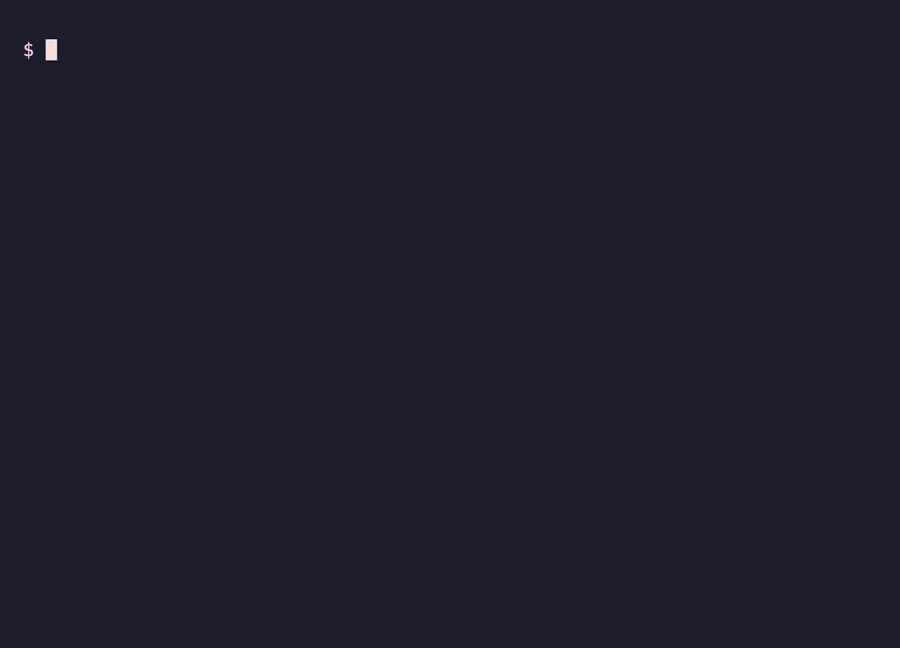

# pixelforge

[](https://github.com/colebrumley/pixelforge/actions/workflows/ci.yml)

pixelforge turns raster images into 16-bit-style pixel art (sprites, backgrounds and
tiles), and its built-in editor lets you touch up the result by hand. Except with
`--remove-bg`, the same input and config give the same PNG on every run.



## Quick start

The demo above, step by step. Convert a 1254×1254 illustration (`samples/knight_sprite.png`
in this repository, copied to `knight.png`) to a 64 px sprite:

```bash
pixelforge convert knight.png --preset sprite --method gerstner -o out
```

`out/` now holds the sprite (`knight.png`), a nearest-neighbor upscale, the palette and a
metadata file. stdout carries a JSON summary.

Open the result in the editor, with the input beside it for reference:

```bash
pixelforge edit out/knight.png --source knight.png
```

Fix what the conversion got wrong, a broken outline here, and save with Cmd/Ctrl+S. Saving
rewrites every output file and adds `out/knight_edits.json`, a log of the edits. Replay that
log on a fresh conversion and the edited PNG comes back byte for byte:

```bash
pixelforge convert knight.png --preset sprite --method gerstner -o replay \
  --edits out/knight_edits.json
```

Other commands:

```bash
pixelforge convert scene.png --preset background           # also writes a tileset and tilemap
pixelforge batch frames/ --preset sprite                    # one shared palette for all frames
pixelforge compare hero.png -o out                          # box, kopf, gerstner side by side
pixelforge compare photo.png --prepass                      # proof sheet: methods × pre-pass
pixelforge compare hero.png --sweep palette-size=8,12,16    # proof sheet: methods × one option
pixelforge palettes                                         # list bundled palettes
pixelforge convert hero.png --preset sprite --edit          # convert, then open the editor
```

## What it does

Each run uses one of three downscalers:

- **box**: the naive mean-color baseline, with a median-cut palette.
- **kopf**: content-adaptive downscaling (Kopf, Shamir, Peers; SIGGRAPH Asia 2013). Edges
  stay sharp and thin lines survive.
- **gerstner**: joint superpixel and palette optimization (Gerstner et al.; Computers &
  Graphics 2013). Segmentation and palette converge together.

An optional pre-pass (`--enhance`, `--ink`) exaggerates small features so photos stay
readable. Post-processing adds palette ramp regularization, selective ordered dithering,
orphan-pixel removal, jaggy cleanup, sprite outlines, and optional tileset and tilemap
extraction. The bundled palettes are NES, Game Boy, Genesis, SNES and PICO-8.

The editor fixes what the conversion gets wrong: a stray pixel, a broken outline, a muddy
patch. It edits the indexed image and its palette and keeps every output file consistent.
It is not a general paint program: no layers, no animation, no free RGB painting.

Output is deterministic, with two limits: `--remove-bg`, and best-effort identity across CPU
architectures. See [Determinism](docs/determinism.md).

## Install

pixelforge is a single Rust program. It needs a stable Rust toolchain and nothing else (no
Python). Get Rust with

```bash
curl --proto '=https' --tlsv1.2 -sSf https://sh.rustup.rs | sh   # or: brew install rustup
```

pixelforge is not on crates.io. Install it from GitHub:

```bash
cargo install --git https://github.com/colebrumley/pixelforge pixelforge
```

The first install compiles the program, which takes a minute or two. Linux and macOS are
supported. Windows is not: nothing is built or tested there.

The editor is the `gui` Cargo feature, on by default. On Linux it opens X11 or Wayland at
run time and needs no development headers to build. For a command-line-only build without
the window toolkit, add `--no-default-features --features cli`. Every command still works
there, `--edits` replay included; `edit` and `--edit` explain that the editor is not built
in.

pixelforge uses every core by default. `PIXELFORGE_THREADS=N` limits it. The thread count
changes speed only, never the output.

Two optional extras:

- **AI background removal.** `--remove-bg` runs the external `rembg` command, which must be
  on `PATH` (`pipx install 'rembg[cli]'`). No preset turns it on, whether rembg is installed
  or not. rembg downloads its model on first use. The model is outside the determinism
  guarantee, and its license is the model's own. `_meta.json` records `rembg --version`.
- **Python binding.** The same library from Python (`Config`, `run`, `Result`, numpy arrays
  in and out). The CLI does not need it. Building it needs the Rust toolchain too:
  `pip install 'git+https://github.com/colebrumley/pixelforge#subdirectory=crates/pixelforge-py'`.
  See [Library](docs/library.md) and [crates/pixelforge-py/README.md](crates/pixelforge-py/README.md).

## Samples

Source on the left, pixelforge output on the right (nearest-neighbor upscaled).

`pixelforge convert knight.png --preset sprite --method gerstner`: 1254×1254 → 64 px on the
longest edge, 17 colors, backdrop keyed out. The canvas is exactly the requested size, and
the outline is drawn inside it. The outline adds a palette entry. With a named palette it
snaps to the nearest palette color instead.


`pixelforge convert town.png --preset background --method gerstner`: 1254×1254 → 256×256,
32 colors, plus a tileset and tilemap.


`pixelforge convert portrait.png --preset sprite --outline none --no-key-bg`, without (middle)
and with `--enhance 1` (right): 1024×1024 → 64×64, 16 colors. The pre-pass keeps the eyes,
brows and mouth that plain downscaling averages away (see [Photos](docs/cli.md#photos---enhance-and---ink)).
The source photo is AI-generated.


## Documentation

| guide | covers |
| --- | --- |
| [Command line](docs/cli.md) | options and config files, output files and sizes, palettes, backdrops, photos, proof sheets, logging, limits |
| [Editor](docs/editor-guide.md) | opening files, tools and shortcuts, batches, the edit log and replay |
| [Library](docs/library.md) | the Rust crate and the Python binding |
| [Determinism](docs/determinism.md) | what is guaranteed, how it is tested, differences from the Python version |
| [Development](docs/development.md) | tests and the `xtask` tooling |

Background for contributors:

- [DESIGN.md](DESIGN.md): how each method works, the implementation and its numerics, the
  full determinism contract, timings, and every deliberate deviation from the spec.
- [docs/editor.md](docs/editor.md): the editor's requirements and design.
- [REQUIREMENTS.md](REQUIREMENTS.md): the specification the original Python prototype was
  built from (historical).
- [crates/pixelforge/README.md](crates/pixelforge/README.md): the crate layout and the
  numerical rules for contributors.

## License

MIT; see [LICENSE](LICENSE). Changes are listed in [CHANGELOG.md](CHANGELOG.md).
