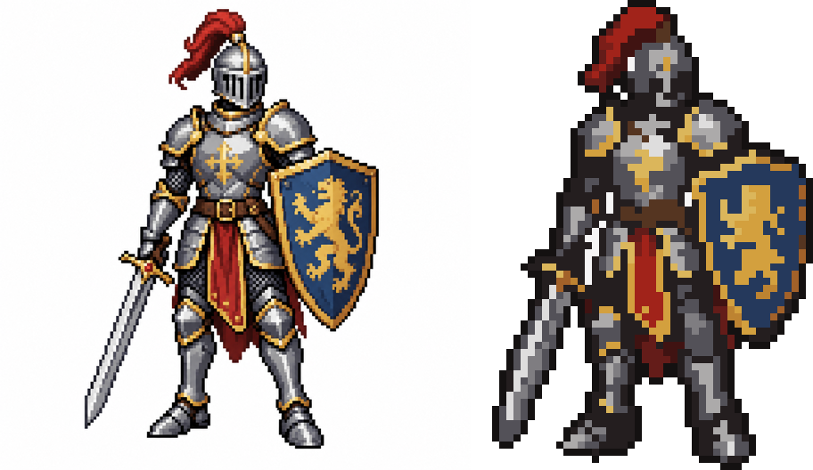
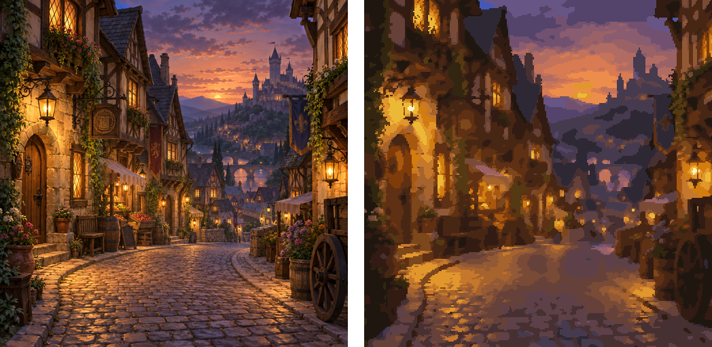
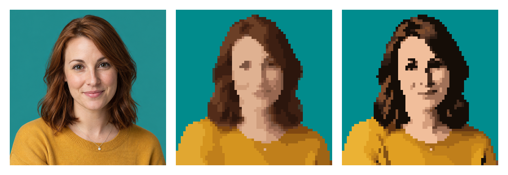

# pixelforge

[](https://github.com/colebrumley/pixelforge/actions/workflows/ci.yml)

pixelforge converts raster images into 16-bit-style pixel art: sprites, backgrounds and
tiles. It is deterministic: the same input and the same config give the same PNG on every
run. There are two limits, `--remove-bg` and best-effort identity across CPU architectures;
see [Determinism](#determinism).

You pick one of three downscalers per run:

- **box**: the naive mean-color baseline, with a median-cut palette.
- **kopf**: content-adaptive downscaling (Kopf, Shamir, Peers; SIGGRAPH Asia 2013). Edges
  stay sharp and thin lines survive.
- **gerstner**: joint superpixel and palette optimization (Gerstner et al.; Computers &
  Graphics 2013). Segmentation and palette converge together.

An optional pre-pass (`--enhance`, `--ink`) exaggerates small features so photos stay
readable. Post-processing adds palette ramp regularization, selective ordered dithering,
orphan-pixel removal, jaggy cleanup, sprite outlines and optional tileset and tilemap
extraction. The bundled palettes are NES, Game Boy, Genesis, SNES and PICO-8.

## Samples

Source on the left, pixelforge output on the right (nearest-neighbor upscaled).

`pixelforge convert knight.png --preset sprite --method gerstner`: 1254×1254 → 64 px on the
longest edge, 17 colors, backdrop keyed out. The canvas is exactly the requested size, and
the outline is drawn inside it. The outline adds a palette entry. With a named palette it
snaps to the nearest palette color instead.



`pixelforge convert town.png --preset background --method gerstner`: 1254×1254 → 256×256,
32 colors, plus a tileset and tilemap.



`pixelforge convert portrait.png --preset sprite --outline none --no-key-bg`, without (middle)
and with `--enhance 1` (right): 1024×1024 → 64×64, 16 colors. The pre-pass keeps the eyes,
brows and mouth that plain downscaling averages away (see [Photos](#photos---enhance-and---ink)).
The source photo is AI-generated.



## Install

pixelforge is a single program written in Rust. It needs a stable Rust toolchain and nothing
else (no Python). Get Rust with

```bash
curl --proto '=https' --tlsv1.2 -sSf https://sh.rustup.rs | sh   # or: brew install rustup
```

pixelforge is not published to crates.io. Install it straight from GitHub:

```bash
cargo install --git https://github.com/colebrumley/pixelforge pixelforge
```

The first install compiles the program, which takes a minute or two. Linux and macOS are
supported. Windows is not: nothing is built or tested there.

pixelforge uses every core by default. Set `PIXELFORGE_THREADS=N` to limit it. The thread
count changes speed only, never the output.

### Optional: AI background removal

`--remove-bg` runs the external `rembg` command, which must be on `PATH`:

```bash
pipx install 'rembg[cli]'
```

AI matting is opt-in: no preset enables it, whether rembg is installed or not. rembg
downloads its model on first use. The model is outside the determinism guarantee, and its
license is the model's own. `_meta.json` records `rembg --version`.

### Optional: Python binding

The Python binding calls the same library from Python (`Config`, `run`, `Result`, numpy
arrays in and out). The CLI does not need it. Building it needs the Rust toolchain too:

```bash
pip install 'git+https://github.com/colebrumley/pixelforge#subdirectory=crates/pixelforge-py'
```

See [Library](#library) and [crates/pixelforge-py/README.md](crates/pixelforge-py/README.md).

## CLI

```bash
pixelforge convert hero.png --preset sprite --method gerstner --palette-size 12
pixelforge convert scene.png --preset background           # writes tileset + tilemap
pixelforge batch frames/ --preset sprite                    # one shared palette for all
pixelforge compare hero.png -o out                          # box, kopf, gerstner side by side
pixelforge compare photo.png --prepass                      # proof sheet: methods × pre-pass
pixelforge compare hero.png --sweep palette-size=8,12,16    # proof sheet: methods × one option
pixelforge palettes                                         # list bundled palettes
```

### Options and config files

Every config field is a `--kebab-case` flag. Booleans take `--flag/--no-flag`. `g_T_final`
is `--g-t-final`, and the old `--g-T-final` still works. `pixelforge convert --help` lists
each flag with its description, per-preset default and allowed values.

`--config file.json` loads a config. Precedence is defaults ← preset ← JSON ← flags. In the
library, `Config::replace` with a new `preset` re-applies it to every field not set
explicitly.

### Output files

`convert` writes to `OUTDIR` (default `out/`):

| file | content |
| --- | --- |
| `NAME.png` | native-resolution result (palette-indexed PNG) |
| `NAME_preview.png` | nearest-neighbor upscale |
| `NAME_palette.json`, `NAME_palette.hex` | the palette (LAB rounded to 6 decimals); `.hex` is reusable via `--palette-name`; `.json` entries carry `"used"` (unused entries are kept, so named palettes stay complete) |
| `NAME_meta.json` | stats, timings, config, config hash, input hash, palette, environment (`platform`, `threads`, and `native`, the pixelforge version; not hashed) |
| `NAME_tileset.png`, `NAME_tilemap.json` | background preset only; tiles merge when mean ΔE < `tile_dedupe_tolerance` and every pixel's ΔE < 10 (flips included) |
| `NAME.tmj` | background preset only: Tiled JSON map (one `background` layer, flips in the GID high bits, tileset embedded and pointing at `NAME_tileset.png`) |
| `NAME_tilemap.csv` | background preset only: one line per tile row of GIDs (1-based, 0 = empty, no flip bits) |

`--tileset-columns N` sets the tileset sheet width in tiles. The default, 0, means
`ceil(sqrt(tiles))`.

`--transparent-index` sets where transparency sits in the PNG palette:

- `last` (the default) puts it after the colors.
- `first` puts it at index 0 and shifts every color by one, as Aseprite and console tools
  expect. It also adds a leading `{"hex": null, "transparent": true}` entry to
  `_palette.json` and a `; transparent` comment line to `_palette.hex`.

The library's `indices` always use −1 for transparent.

`convert`, `batch` and `compare` refuse (exit 2) to write an output over an input file.
`batch` also refuses inputs that share a name (`a.png`, `a.bmp`). `--force` overrides both.
`batch` skips `*_preview`, `*_tileset` and `*_compare` images.

### Output size

`--scale N` fixes the downscale ratio: the output is the cropped input divided by N per
axis. `--canvas WxH` fits the subject inside a fixed canvas, centered, outline included.
Neither combines with `--out-width/--out-height`.

Unless `--scale`, `--canvas` or both `--out-*` flags are given, `batch` derives one scale
from the largest frame's subject and gives every frame the same canvas. Animation frames
cropped to their alpha then keep a constant size. The first JSON line reports `scale` and
`canvas`.

With a tileset, a derived size must be a multiple of `--tile-size`. `--fit` chooses how:

- `pad` (the default) keeps the aspect and pads with transparent pixels, centered.
- `stretch` scales to fill, and warns if the aspect changes by more than 2 %.
- `crop` crops the input, centered.

Inputs much larger than the output are box-reduced to 8–16× the output size before denoising
(`--prereduce-max-ratio`, 0 disables).

### Palettes

`--palette-name` takes a bundled name, a `.hex`/`.gpl` path, or inline colors
(`hex:ff0000,00ff00,…`). `batch` writes its shared palette to `shared_palette.hex` and hands
it to every frame inline, so the frames' metadata carries the colors, not the output path.

### Backdrops and transparency

The sprite preset keys out a flat opaque backdrop without rembg (`--no-key-bg` disables
it). That includes the anti-aliased fringe where the subject blends into the backdrop
(`key_bg_fringe`).

`key_bg` only keys a backdrop that covers at least 90 % of the image border within
`--key-bg-tolerance`. Two kinds of input fail that test: a mottled studio backdrop is not
flat, and a head-and-shoulders shot cut off by the bottom edge has too little backdrop on
the border. In both cases the backdrop stays in the picture and takes part in the levels
stretch. To get a sprite with a transparent background, cut the subject out first with
`--remove-bg` or an input with an alpha channel.

Pixels at or above `alpha_threshold` are opaque. Each still counts in the downscaled colors
in proportion to its alpha, so a semi-transparent fringe pulls its neighbors less.

Orphan removal keeps high-contrast single pixels such as 1-px eyes and highlights. A stray
pixel is merged only when it is within ΔE `orphan_max_delta` (default 25) of its
replacement.

### Photos: `--enhance` and `--ink`

Photos have soft gradients and no lines, so features smaller than an output pixel (eyes, a
mouth, a chain) get averaged away. `--enhance` exaggerates them before downscaling. It
stretches the subject's brightness to the full range and adds local contrast at
`--enhance-radius` (2) output pixels. Try `0.5` to `1`. Higher values (up to 4) turn dark
areas such as hair solid black. `--ink 0.6` also darkens thin dark features into lines, and
it adds blots on some images.

The right values depend on the photo, so pick them from a [proof sheet](#proof-sheets). Both
options are off by default and in every preset. Sources that already have outlines and full
contrast (illustrations, pixel art) lose their mid-tone shading to them.

Colors keep their hue: a pixel is brightened only as far as its brightest channel allows.
The stretch maps the subject's 1st and 99th brightness percentiles to black and white. It
never amplifies by more than 5×, so a nearly flat subject stays nearly flat.
`--enhance-black` / `--enhance-white` set the two levels by hand. `batch` measures one pair
of levels over all frames (reported in its first JSON line), so a flash in one frame does not
change the rest of it. `--seamless` tiles stay seamless.

A source photo converts best when:

- the subject fills the frame (a feature needs 3–4 output pixels to survive),
- the light is flat and frontal,
- the backdrop is one flat color that differs from hair and skin (see
  [Backdrops and transparency](#backdrops-and-transparency)), and
- adjacent parts differ in tone.

### Proof sheets

`compare --prepass` and `compare --sweep FIELD=V1,V2,...` write one labelled sheet
(`INPUT_compare.png`) instead of each method's outputs: a row per method, a column per
setting.

- `--prepass` uses four columns, from no pre-pass to `--enhance 1 --ink 0.6`.
- `--sweep` takes one option other than `--method`, given once. Use `on`/`off` for booleans
  and `none` to unset. Values are split on commas, so inline `hex:` palettes cannot be
  swept.
- `--method` limits the sheet to that row.

The JSON result lists, per cell, its `flags` and its full `config`:

- The `flags` cover only the method and the swept setting. Add them to a `convert` call with
  the same base flags and `--config` file that `compare` was given.
- The `config` is the whole cell. Save it as JSON and pass it with `--config` to reproduce
  the cell on its own. It is also the only way to replay a cell that unsets a value with
  `none`, which no flag can do.

Previews are scaled down from `--scale-preview` when a sheet would exceed 32 million pixels.
Every cell is a full run, so a 3 × 4 sheet with kopf and gerstner takes minutes at large
sizes. Pick settings at a small `--out-height`, then convert at full size.

### Logging and errors

Runs take from under a second (box) to a minute or more (kopf and gerstner at large sizes).
They are silent until the JSON result unless asked:

- `pixelforge -v convert ...` logs each stage with its duration to stderr.
- `-vv` logs every downscaler iteration.
- `-q` logs only errors.

stdout carries only the JSON results. Library callers get the same messages through the
`log` crate (targets under `pixelforge`).

Errors print one line. The exit code is 2 for configuration problems (bad flags, unknown
palette, `--remove-bg` without rembg) and 1 for anything else. `pixelforge --debug ...` or
`PIXELFORGE_DEBUG=1` prints the full error chain instead.

### Limits

Inputs larger than 24 million pixels (`width × height`) are refused before decoding. Raise
or lower the budget with `--max-input-pixels N` (the `max_pixels` argument of the library's
`run`). Only PNG, JPEG, GIF, WEBP, BMP and TIFF are read, and only regular files. Numeric
config fields have upper bounds (e.g. output edges ≤ 4096, `--scale-preview` ≤ 64), and
non-finite numbers are rejected.

## Library

The `pixelforge` crate is also a Rust library. Depend on it without the CLI:

```toml
[dependencies]
pixelforge = { git = "https://github.com/colebrumley/pixelforge", default-features = false }
```

```rust
use std::path::Path;

use pixelforge::config::{Config, Value};
use pixelforge::io::ArrayData;
use pixelforge::pipeline::{self, Input};

fn main() -> Result<(), pipeline::Error> {
    let cfg = Config::new(&[
        ("preset".into(), Value::str("sprite")),
        ("method".into(), Value::str("gerstner")),
        ("palette_size".into(), Value::Int(12)),
        ("out_height".into(), Value::Int(48)),
    ])?;
    let out = pipeline::run(Input::Path(Path::new("hero.png")), &cfg, None)?;
    out.save(Path::new("out/hero"))?; // out/hero.png, hero_preview.png, hero_palette.json, ...
    // out.image: RGBA8 (h * w * 4); out.palette: [u8; 3] per entry;
    // out.indices: palette index per pixel, -1 = transparent; out.stats: the stats JSON

    let photo = cfg.replace(&[("enhance".into(), Value::Float(0.5))])?; // ink 0.6 adds lines
    let rgba: Vec<u8> = (0..64 * 64 * 4).map(|i| (i % 251) as u8).collect();
    let array = Input::Array { shape: &[64, 64, 4], data: ArrayData::U8(&rgba) };
    pipeline::run(array, &photo, None)?; // (H, W, 3|4): u8, or f64 in [0, 1]
    Ok(())
}
```

`pipeline::run(input, &config, max_pixels)` applies the same pixel budget (`None`: 24
million) to every input kind. `input_sha256` hashes the file bytes for a path, and the shape
plus RGBA bytes for in-memory images. `Config::new` applies the field defaults, then the
preset, then the given fields. `config::PRESETS` lists the presets.

Errors:

- `pipeline::Error::Config` for invalid configs, returned by `Config::new`, or for an
  unreadable `palette_name` file at the start of `run`. The CLI exits 2.
- `Error::Pixelforge` and `Error::Io` for everything else pixelforge reports, such as
  undecodable, oversized or fully transparent input. The CLI exits 1.

The optional Python binding ([Install](#optional-python-binding)) wraps the same pipeline:

```python
from pixelforge import Config, run

cfg = Config(preset="sprite", method="gerstner", palette_size=12, out_height=48)
res = run("hero.png", cfg)   # or a numpy (H, W, 3|4) array, or a PIL image with Pillow
res.save("out/hero")         # the files `pixelforge convert` writes, byte for byte
res.image                    # numpy RGBA (H, W, 4) uint8; res.palette (K, 3); res.indices (H, W)
```

Its errors are `ConfigError` (also a `ValueError`) and `PixelforgeError` (its base class).

## Determinism

pixelforge has no unseeded randomness and no dependence on thread scheduling or the wall
clock, and it uses float64 throughout. `cargo test` (`crates/pixelforge/tests/determinism.rs`
and `cli.rs`) enforces identical output bytes for every method and preset, in-process and
across fresh processes with different thread counts.

- The program is self-contained, so byte identity across machines does not depend on the
  versions of any installed library. Every transcendental function comes from the pure-Rust
  `libm` crate, and rounding is half to even. Threads split the work into a fixed partition
  merged in a fixed order, so `PIXELFORGE_THREADS` changes speed only.
- CI checks `tests/golden.json` (pixel hashes per fixture, method and preset) on Linux
  x86-64 and macOS arm64.
- Across CPU architectures identity is still best-effort at the last bits of a float64, which
  rounding to 8-bit colors has absorbed in every case tested.
- `--remove-bg` (rembg) is outside the guarantee and is never on by default.
- Each output PNG carries `tEXt` chunks: `pixelforge:config` (canonical config JSON),
  `pixelforge:input_sha256` (input file bytes) and, when a palette is given,
  `pixelforge:palette_sha256` and `pixelforge:palette` (its `rrggbb` colors). The config hash
  covers the config, the version and the palette's colors, so editing a palette file changes it.
- `_meta.json` also records the platform, the thread count and the pixelforge version (not
  hashed), to tell which of these differ when two outputs do.

### Differences from the Python version

pixelforge was a Python program until 0.2.0. Against the last Python version (which still
reported 0.1.0):

- Outputs from PNG, BMP, TIFF, GIF and WEBP inputs are pixel-identical, except one gerstner
  case that sits on a near-tie (10 pixels of one 256×256 test output).
- JPEG inputs decode within a few levels of Pillow's libjpeg, so outputs from JPEG sources
  differ.
- Seeded gerstner runs (`--seed`) draw from a different random stream.
- Every config hash changed with the version.

[DESIGN.md](DESIGN.md#implementation) has the details.

## Development

```bash
git clone https://github.com/colebrumley/pixelforge && cd pixelforge
cargo test --workspace -- --include-ignored   # full suite, including the slow kopf cases
cargo test --workspace                        # without them
```

The `xtask` crate holds the developer tooling (`cargo xtask <command> --help` lists the
options):

- `cargo xtask fixtures --check`: compare the committed `tests/fixtures/` with the synthetic
  test images drawn from code (`cargo xtask fixtures DIR` writes them).
- `cargo xtask golden`: regenerate `tests/golden.json` after an intentional output change,
  and commit the diff with the change. `--check` only reports whether it is up to date.
- `cargo xtask bench`: time every method and preset on a few fixtures, print the per-stage
  timings and write `bench/<git sha>.json` (`--compare bench/OLD.json` for speedups).
- `cargo xtask snapshot save`, then `cargo xtask snapshot compare` after a change: per case,
  whether the output is identical, how many pixels differ and their ΔE (exit 1 if any differ).
- `cargo xtask gallery` (`--quick` for smaller backgrounds): render every method × preset on
  the fixtures plus any PNGs in `samples/` into `gallery/index.html`.
- `cargo xtask help-record`: record each command's `--help` in `tests/cli_help/`, which the
  CLI tests compare with the live output.

## More

- [DESIGN.md](DESIGN.md): how each method works, the implementation and its numerics, the
  full determinism contract, timings, and every deliberate deviation from the spec.
- [REQUIREMENTS.md](REQUIREMENTS.md): the specification the original Python prototype was
  built from (historical).
- [crates/pixelforge/README.md](crates/pixelforge/README.md): the crate layout and the
  numerical rules for contributors.

## License

MIT; see [LICENSE](LICENSE). Changes are listed in [CHANGELOG.md](CHANGELOG.md).
